<p align="center">
  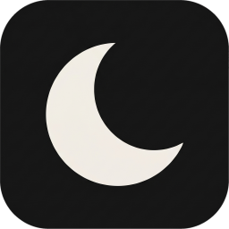
</p>

<h1 align="center">Luna</h1>

<p align="center"><b>English</b> · <a href="README.md">Polski</a></p>

<p align="center"><i>A browser as clear as a starry sky.</i></p>

<p align="center">
  <b>A light, dark browser for Windows, Linux and macOS</b> – with tiles, widgets, split screen,<br>
  built-in ad blocking and an AI assistant right next to the page. It installs new versions by itself.
</p>

<p align="center"><sub>A one-person project · interface in Polish · <a href="#about-the-project">more</a></sub></p>

<p align="center">
  <a href="https://github.com/z4k0lzakol/Luna/releases/latest"></a>
  <a href="https://github.com/z4k0lzakol/Luna/actions/workflows/release.yml"></a>
  <a href="LICENSE"></a>
  
</p>

<p align="center">
  <a href="https://github.com/z4k0lzakol/Luna/releases/latest/download/Luna-Windows-Setup.exe"><b>Download for Windows</b></a> ·
  <a href="https://github.com/z4k0lzakol/Luna/releases/latest">Linux and macOS</a> ·
  <a href="https://github.com/z4k0lzakol/Luna/releases/latest/download/Luna-Android.apk">Android</a> ·
  <a href="https://z4k0lzakol.github.io/Luna/en/#film">Film</a> ·
  <a href="#how-to-install">How to install</a> ·
  <a href="#what-it-can-do">What it can do</a> ·
  <a href="#what-its-good-for">What it's good for</a> ·
  <a href="#roadmap">Roadmap</a> ·
  <a href="https://z4k0lzakol.github.io/Luna/privacy.html">Privacy (PL)</a> ·
  <a href="https://z4k0lzakol.github.io/Luna/regulamin.html">Terms (PL)</a> ·
  <a href="LICENSE">GPL v3 license</a>
</p>

<p align="center">
  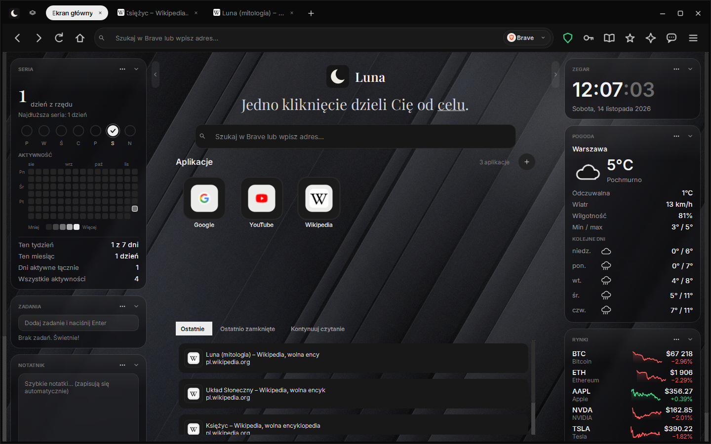
</p>

<p align="center">
  <a href="https://z4k0lzakol.github.io/Luna/en/#film">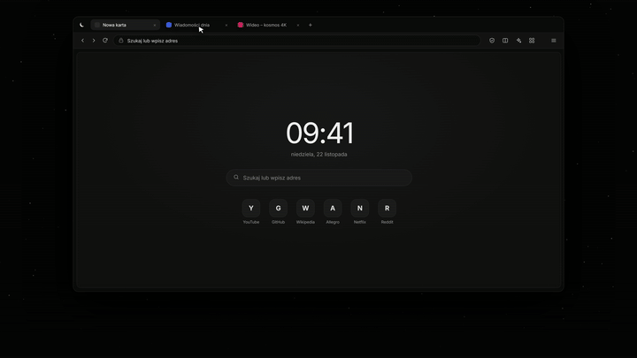</a><br>
   <b><a href="https://z4k0lzakol.github.io/Luna/en/#film">Watch the full film: Luna in 50 seconds</a></b> (with sound)<br>
   <b><a href="https://z4k0lzakol.github.io/Luna/en/#poradnik">Guide: first steps in 3 minutes</a></b> – step by step, Polish captions
</p>

<p align="center"><sub>
   Calm as a full-moon night · Your light in the dark of the web · Every tab in its own orbit
</sub></p>

---

## Why Luna

- **Everything in one window.** Web pages, messengers, an AI assistant and widgets (weather, tasks, notes, markets) side by side – no extensions to install.
- **Private from the very first page.** Ad and tracker blocking is built in, passwords are encrypted on your computer, and Luna has no servers of its own and collects nothing about you.
- **Fast and frugal.** Pages load over HTTP/3 (QUIC) when the server supports it, and panel and scrolling animations run in step with your display's refresh rate (120/144 Hz included). Unused tabs go to sleep on their own, and on battery Luna pauses background videos and frees up memory.
- **Interface in Polish.** The whole interface, hints, page menus and the tour are in Polish. Any web page can be translated from any language in one click.
- **Calm as a full-moon night.** A dark night-sky look, smooth animations and soft sounds (mute them with one click).
- **Changes phases on its own.** The installed Luna downloads new versions in the background, verifies their checksum and installs them when you close it.

## What it can do

<table>
<tr>
<td width="50%">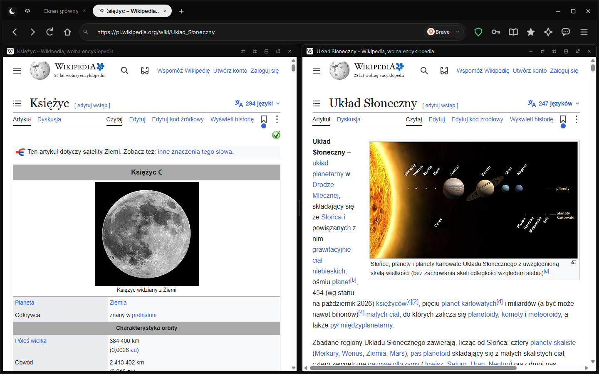</td>
<td width="50%">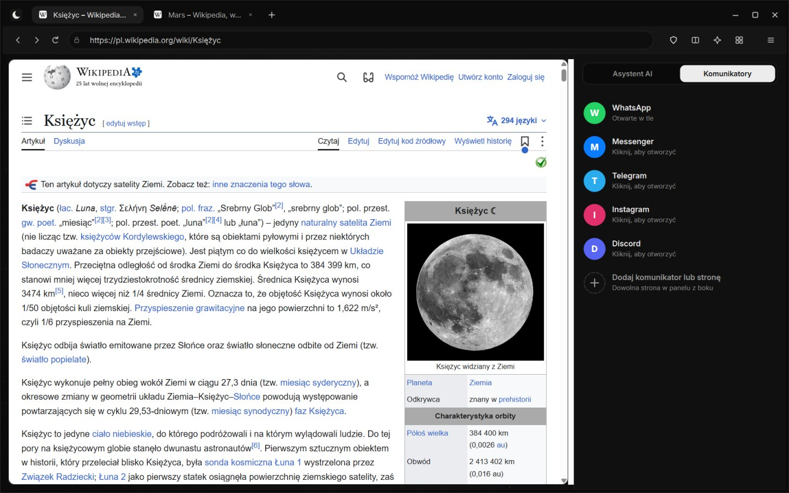</td>
</tr>
<tr>
<td><b>Split screen</b> – <i>every tab in its own orbit</i>: drag a tab onto the page – two or three pages side by side, saved layouts, synced scrolling.</td>
<td><b>AI assistant and messengers</b> in a panel next to the page – switch between them at the top.</td>
</tr>
<tr>
<td>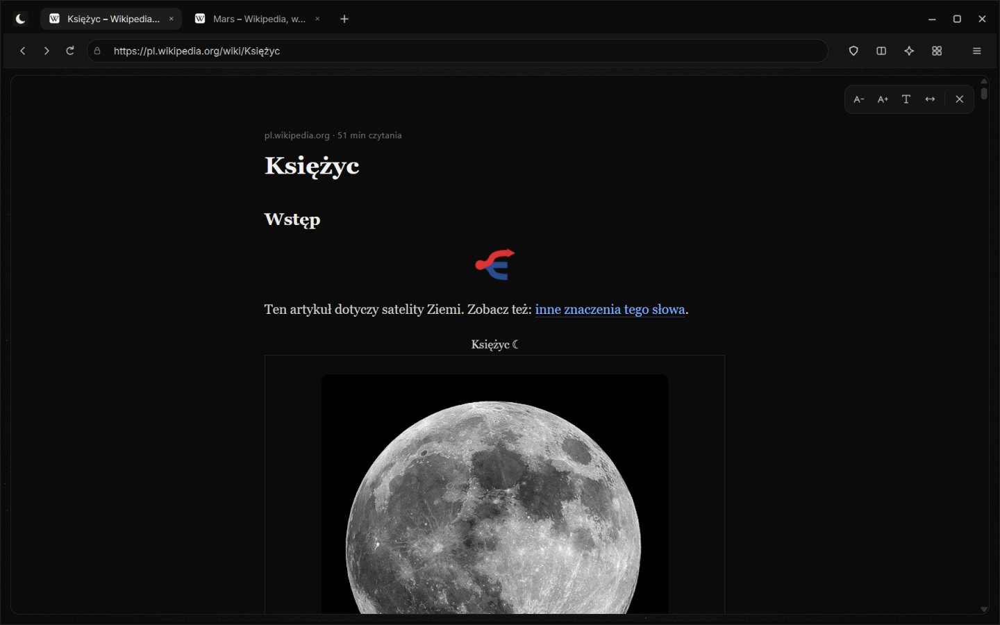</td>
<td>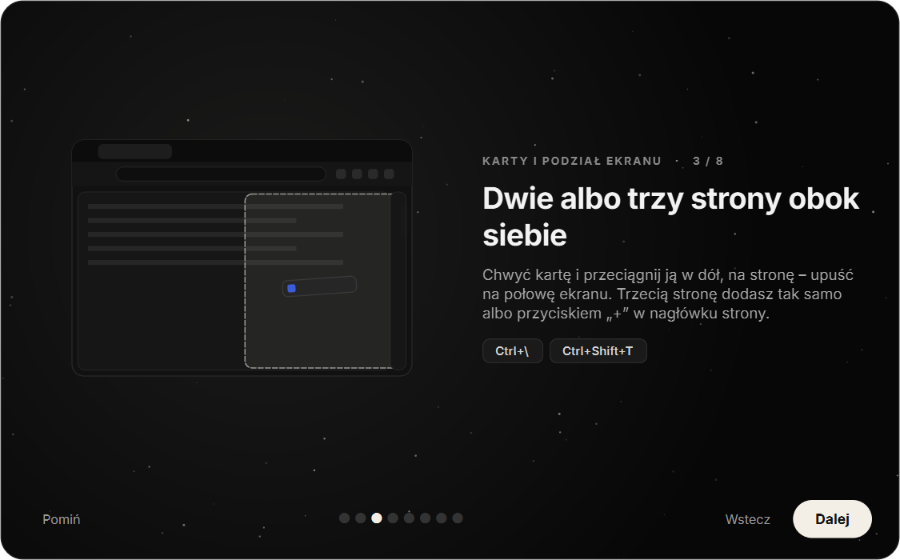</td>
</tr>
<tr>
<td><b>Reader mode</b> – just the article text, without ads or distractions (F9).</td>
<td><b>The Luna tour</b> – eight short animated steps on first launch.</td>
</tr>
</table>

**Tabs and windows**
- Tab groups, workspaces (e.g. Work, Shopping), pinned tabs, a vertical tab panel.
- Split screen with 2–3 pages, a preview while dragging, and saved layouts (“Work: Gmail + Calendar + Notion”).
- Profiles – a separate Luna for work and for home, each with its own tabs, passwords and logins.
- Recently closed tabs come back with their history (Ctrl+Shift+T), and the home screen brings them back in one click.

**Privacy and security**
- Ad and tracker blocking (uBlock Origin lists, EasyList, Polish filters), including YouTube ads and pop-ups. When YouTube makes you wait for a video to start after an ad is blocked, Luna immediately reloads it in ad-free mode (it starts in about 5 s instead of 11 s), and videos opened from the address bar or a bookmark play on their own.
- Skipping sponsored segments on YouTube (SponsorBlock).
- A password manager encrypted on your computer, 2FA codes, addresses for forms.
- Warnings about fake login pages (lookalikes of banks and other services).
- Hide any element on a page with a right-click.

**Everyday comfort**
- The **Ctrl+K** command palette – commands, tabs, history and settings in a single box.
- Search apps straight from the address bar: `yt concert`, `sp lofi`, `tt @name`, `ig #sea`.
- Page and selection translation, dark mode for light pages, picture-in-picture, screenshots (including full-page).
- “Read later” with an offline copy, highlights and notes on pages, link previews without opening a tab.
- Search by image (**Ctrl+Shift+X**) – select part of a page: Google Lens or a question for the AI.
- A bookmark manager with export and import (HTML file compatible with Chrome, Edge, Firefox and Safari).

**AI and messengers**
- An AI side panel: ChatGPT, Claude, Gemini or DeepSeek – “Summarize page”, “Ask about page”, “Compare tabs”.
- A messengers panel: WhatsApp, Messenger, Telegram, Instagram, Discord and any website you like.

**Widgets** – activity streak, tasks, notepad, Pomodoro, clock, weather, markets and currencies, RSS news, parcels (InPost, DPD, DHL…), a music player (it also controls Spotify), resource monitor, calculator, translator and more – all in the Widget Store (Ctrl+Shift+E).

<table>
<tr>
<td width="40%">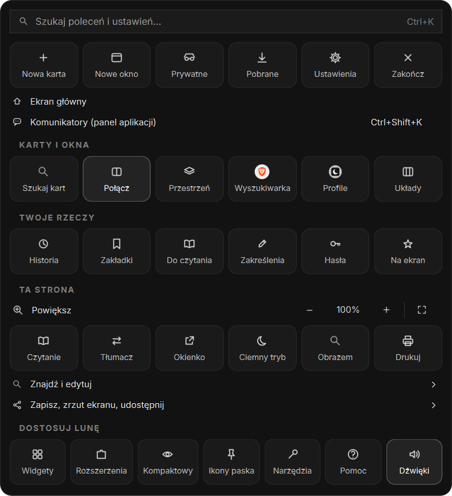</td>
<td width="60%" valign="top">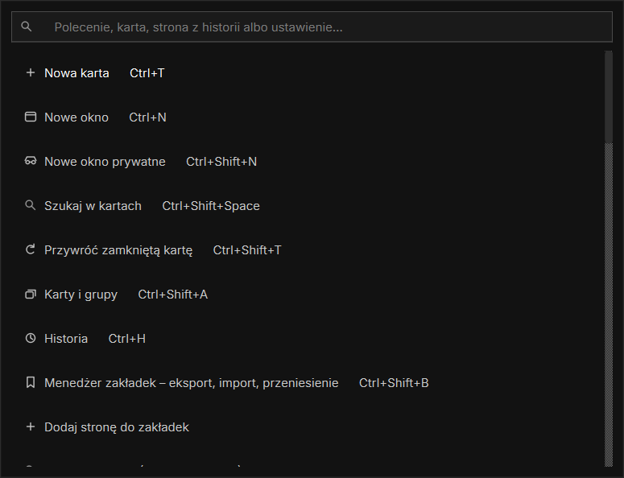</td>
</tr>
<tr>
<td>Luna's tiled menu – common actions, your stuff and page tools.</td>
<td>The Ctrl+K palette – commands, tabs and history in a single box.</td>
</tr>
</table>

## Luna on your phone

<p align="center">
  <a href="https://z4k0lzakol.github.io/Luna/en/#telefon">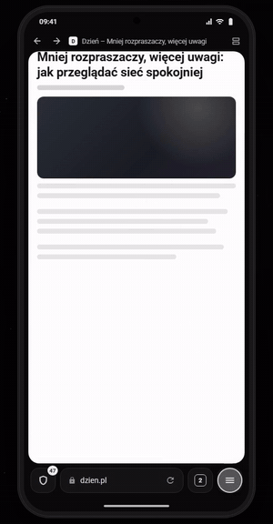</a><br>
   <b><a href="https://z4k0lzakol.github.io/Luna/en/#telefon">Watch the film: Luna on your phone</a></b> (with sound)
</p>

<p align="center">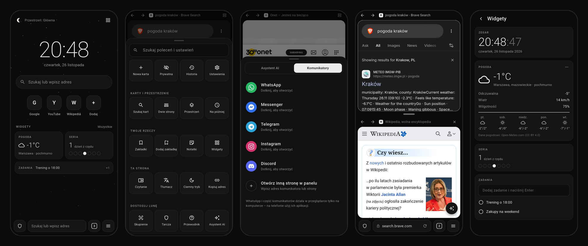</p>

The same Luna on Android – **[download `Luna-Android.apk`](https://github.com/z4k0lzakol/Luna/releases/latest/download/Luna-Android.apk)** (preview, Android 7 and newer). A home screen with widgets, a bar within thumb's reach (swipe sideways for the next tab, up for all tabs), a menu sheet, the AI assistant and messengers, two pages on one screen, search suggestions, a landscape layout with a top bar, and ad blocking, YouTube included. Code: [`mobile/`](mobile/). The iPhone version is ready in the code and will follow once it has an Apple signature.

## Connected devices

<p align="center">
  <a href="https://z4k0lzakol.github.io/Luna/en/#polaczenie">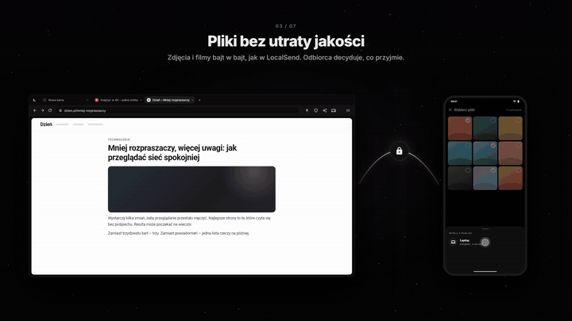</a><br>
   <b><a href="https://z4k0lzakol.github.io/Luna/en/#polaczenie">Watch the film: connected devices</a></b> (with sound)
</p>

Luna on your computer and phone on the same Wi-Fi connect **directly** – no Luna servers, no accounts (Settings → Connected devices; on the phone Menu → Devices):

- **Pairing with a QR code** – the phone scans the code shown on the computer; another computer uses a 6-digit code.
- **A page on the other device** – “Send to device” in the tab, link and page menus; tabs open on other devices in the menu.
- **Files without quality loss** – photos, videos and documents byte for byte (like LocalSend), also via “Share → Luna” on Android; the receiver sees “Accept / Decline”.
- **Shared bookmarks, tiles and Read later** on your home network; the cloud folder still works between computers.
- **One clipboard**, **the phone as a remote** for videos on the computer, and **notifications** (e.g. download finished) on the phone.

The connection is encrypted (TLS with pinned certificates), off by default, and every feature can be switched off on its own. Protocol: [`POLACZENIE_URZADZEN.md`](POLACZENIE_URZADZEN.md) (in Polish).

## What it's good for

| Who | What they get |
|---|---|
| **Work and office** | A “Work” profile kept apart from your personal one, a split layout with mail and calendar in one click, messengers on the side, tasks and Pomodoro in a panel. |
| **Study** | Reader mode, highlights and notes, translation from any language, AI that summarizes an article or explains a selected passage, two pages side by side. |
| **Entertainment** | YouTube without ads or sponsored segments, picture-in-picture, a player in the side panel, `yt` and `sp` shortcuts in the address bar. |
| **Older laptops** | Sleeping tabs, battery saver mode, a task manager that shows what's using memory. |
| **Security** | Tracker blocking, warnings about fake login pages, passwords and 2FA codes kept only on your computer. |

## How to install

 **[Download the latest version](https://github.com/z4k0lzakol/Luna/releases/latest)** and pick the file for your system:

| System | File | Installation |
|---|---|---|
| **Windows 10 / 11** | `Luna-Windows.zip` | Unzip it (right-click → **Extract All**) and run `Luna.exe`. Luna will offer to install itself: a Start menu and desktop shortcut, and uninstalling from Windows Settings. There's also a classic installer, `Luna-Windows-Setup.exe`. |
| **Linux** (x86_64) | `Luna-Linux-x86_64.AppImage` | Make it executable (`chmod +x`) and double-click to run. A `.tar.gz` archive is also available. |
| **macOS** (Apple M1 and newer) | `Luna-macOS-arm64.dmg` | Easiest with one command in Terminal (below). Or open the .dmg, drag Luna into Applications and the first time allow it in **System Settings → Privacy & Security → Open Anyway**. |
| **Android** 7 and newer (preview) | `Luna-Android.apk` | Download it on your phone and open it – Android will ask you to allow installing apps from outside the Play Store. |

**Smart App Control (Windows 11):** if you have it turned on, Windows will block the released Luna for now – this feature doesn't allow new programs without a digital signature to run, and Luna doesn't have one yet (signing is in the works). Until then, run Luna from source (see below) – that way it isn't blocked.

Without a digital signature, Windows may also show “Windows protected your PC” on first launch (click **More info → Run anyway**), and macOS may say “Luna” Not Opened (how to get past it – below).

**macOS without the warning.** Luna isn't signed by Apple yet, so macOS blocks a .dmg downloaded in a browser with ““Luna” Not Opened”. The easiest way is one command in Terminal – it downloads the latest version, copies it into Applications and opens it without the warning:

```bash
curl -fsSL https://raw.githubusercontent.com/z4k0lzakol/Luna/main/packaging/install-mac.sh | bash
```

If you prefer the .dmg: after the first attempt to open it, go to **System Settings → Privacy & Security**, scroll down and click **Open Anyway** next to Luna (or in Terminal: `xattr -dr com.apple.quarantine /Applications/Luna.app`). You only need to do it once – after that Luna downloads and installs new versions itself, without the warning. The .dmg also includes these instructions.

On first launch a **tour** opens: it brings over your bookmarks, history and passwords from Chrome, Edge, Brave, Opera or Vivaldi and helps you set up the look, widgets and AI. Luna downloads and installs new versions by itself (Windows, macOS and Linux); on Android it downloads them and opens the install prompt.

The Linux and macOS versions are the first releases for those systems – some features were designed with Windows in mind (e.g. controlling media players through the system). [Report it](https://github.com/z4k0lzakol/Luna/issues/new/choose) if something doesn't work.

<details>
<summary><b>Running from source (for developers)</b></summary>

Requirements: [Python](https://www.python.org/downloads/) 3.12 or newer (tick “Add python.exe to PATH” in the installer).

```bash
git clone https://github.com/z4k0lzakol/Luna.git
cd Luna
python -m pip install -r requirements.txt
python luna.py
```

Without the black console window: `pythonw luna.py`. A Luna cloned with `git clone` updates in one click (Settings → Updates) and then shows “What's new”.

Your own .exe and installer on Windows: `powershell -ExecutionPolicy Bypass -File build.ps1` (PyInstaller; the installer needs Inno Setup 6). GitHub builds releases for all systems automatically once a version is tagged `v…` (`.github/workflows/release.yml`).
</details>

<details>
<summary><b>Where Luna keeps your data</b></summary>

Everything lives in your user folder (e.g. `C:\Users\<you>` or `/home/<you>`), in files and folders whose names start with `.luna`:

- `.luna_ustawienia.json` – settings, widgets, tab session,
- `.luna.json`, `.luna_historia.json`, `.luna_zakladki.json` – tiles, history, bookmarks,
- `.luna_hasla.bin` – passwords encrypted by Windows (on Linux and macOS, passwords are stored in the system keyring),
- `.luna_profile` – the browser profile (website logins, cookies),
- `.luna_profile_uzytkownikow\<name>` – additional profiles.

You can back up everything into a single encrypted file from the menu: More tools → Backup. Sync between computers works through a OneDrive or Google Drive folder (Settings → Sync) – no Luna servers involved.
</details>

## Roadmap

Plans for upcoming versions:

- [x] **Installer** for Windows, AppImage for Linux and a .dmg image for macOS – no Python needed.
- [x] **Releases on GitHub** – every version with instructions and downloadable files; Luna detects new releases by itself.
- [ ] **Digital signature** – Windows and macOS will no longer show warnings on first launch.
- [x] **Luna for Android** (preview, [`mobile/`](mobile/)) – home screen with widgets, tabs and spaces, menu sheet, AI assistant and messengers, two pages on screen, search suggestions, landscape layout and ad blocking.
- [ ] **Luna for iPhone and iPad** – the app is ready in the code; publishing it requires an Apple signature.
- [x] **Pairing your phone with your computer** – QR pairing, pages, files, bookmarks, tabs, clipboard and remote – without Luna servers.
- [x] **Luna as your default browser** – links from email and other programs open in Luna.
- [ ] **Light theme and accent color**, an archive of old tabs, a portable version (for a USB stick).

Installation goes like this: **download → install → the tour brings over your data from your previous browser** – and that's it.

## Technology and development

| Part | Technology |
|---|---|
| Luna for desktop | Python 3.12+, PyQt6 and Qt WebEngine (Chromium engine) – one program for Windows, Linux and macOS |
| Ad blocking | its own engine compatible with the uBlock Origin / Adblock Plus list syntax (`adblock/`): network rules, cosmetic rules and page scripts |
| Luna for phones | Flutter (Dart), pages rendered by the system engine: Android WebView, WebKit on iPhone (`mobile/`) |
| Releases | GitHub Actions: tagging a version `v…` builds Windows, Linux, macOS and Android packages; every build passes a launch test, and the Windows installer an install/uninstall test |
| Project website | GitHub Pages (`docs/`) |

**Tests.** `python tests/test_site_features.py` runs a real Luna on a temporary profile and checks more than 120 features; the ad-blocking engine has its own tests in `tests/adblock/`, and the phone app is checked with `flutter analyze`. How to contribute: [contributing guide](CONTRIBUTING.md) (in Polish).

## Code signing policy

The code signing policy for Luna's Windows releases.

Free code signing provided by [SignPath.io](https://about.signpath.io), certificate by [SignPath Foundation](https://signpath.org).

> **Status:** the application to SignPath Foundation is in preparation – current releases are not signed yet.

- **What gets signed:** only files built automatically by GitHub Actions from the source code of this repository (`.github/workflows/release.yml`): `Luna.exe` and the `Luna-Windows-Setup.exe` installer. Libraries from other projects (e.g. Qt, PyQt6, Python) are included unmodified.
- **Committers and reviewers:** [z4k0lzakol](https://github.com/z4k0lzakol) – Luna is a one-person project; contributions from others (pull requests) are reviewed before being merged.
- **Approvers:** [z4k0lzakol](https://github.com/z4k0lzakol) – every release is manually approved for signing.
- **Privacy:** Luna does not transfer data to other systems, except for the services needed by the features you use – the full list of what goes to which service and how to turn it off is in the [privacy policy](https://z4k0lzakol.github.io/Luna/privacy.html) (in Polish).
- **Uninstalling:** in Windows Settings (Apps → Luna → Uninstall); user data stays in your home folder.

## License

Luna is free software under the **[GNU GPL v3](LICENSE)** – you may use, modify and share it under the terms of the license. The program comes **without any warranty**.

Additional term (section 7 of GPL v3): the name “Luna” and the Luna logo are not covered by the license – modified versions must be clearly marked as such and may not be presented as the official Luna.

Terms of use: [terms](https://z4k0lzakol.github.io/Luna/regulamin.html) (in Polish) · licenses of components, filter lists and data sources: [licenses](https://z4k0lzakol.github.io/Luna/licencje.html) (in Polish).

## About the project

Luna is developed by a single maintainer – [z4k0lzakol](https://github.com/z4k0lzakol), who is responsible for the code, reviews and releases. Quality is guarded by automated tests that run a real Luna, tests of the ad-blocking engine, and launch and install tests of every release on GitHub. The software is provided without warranty (GNU GPL v3), so keep a backup of anything important. Report bugs and ideas through [GitHub issues](https://github.com/z4k0lzakol/Luna/issues/new/choose).

## Contributing

Have an idea or spotted a bug? Open an [issue](https://github.com/z4k0lzakol/Luna/issues/new/choose). Guidelines (in Polish): [how to help](CONTRIBUTING.md) · [code of conduct](CODE_OF_CONDUCT.md) · report security vulnerabilities privately – [security](SECURITY.md).

## Privacy

Luna runs entirely on your computer and has no servers of its own. Website logins stay in your local profile, passwords are encrypted, and only what you actually use is sent to external services (e.g. a page to translate after you click “Translate”). Details: [privacy policy](https://z4k0lzakol.github.io/Luna/privacy.html) (in Polish).

---

<p align="center"><sub>Luna · Chromium engine via Qt WebEngine · written in Python (PyQt6)</sub></p>
