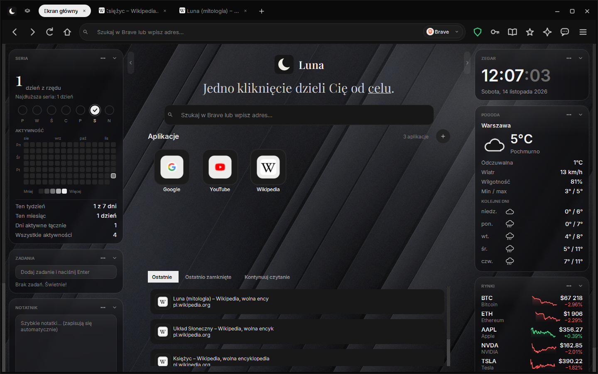
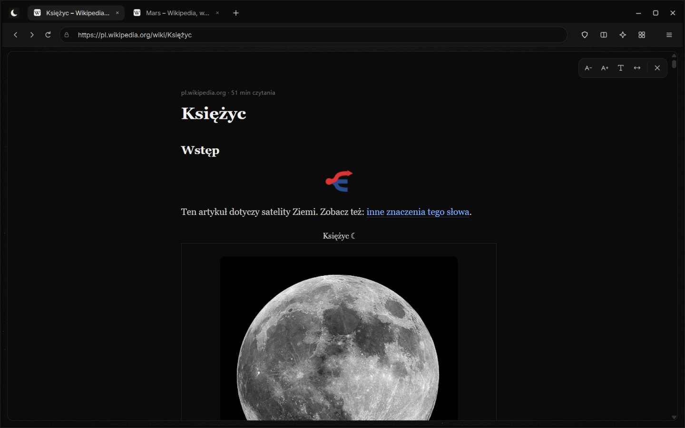

<p align="center">
  
</p>

<h1 align="center">Luna</h1>

<p align="center">
  <b>Lekka, ciemna przeglądarka dla Windows, Linuksa i macOS</b> – z kafelkami, widgetami, podziałem ekranu,<br>
  wbudowaną blokadą reklam i asystentem AI obok strony.
</p>

<p align="center"><sub>Projekt jednoosobowy · vibecoded – tworzony we współpracy z AI (Claude) · <a href="#o-projekcie">więcej</a></sub></p>

<p align="center">
  <a href="https://github.com/z4k0lzakol/Luna/releases/latest"><b>Pobierz</b></a> ·
  <a href="#jak-zainstalować">Jak zainstalować</a> ·
  <a href="#co-potrafi">Co potrafi</a> ·
  <a href="#do-czego-się-przyda">Do czego się przyda</a> ·
  <a href="#co-dalej">Co dalej</a> ·
  <a href="https://z4k0lzakol.github.io/Luna/privacy.html">Prywatność</a> ·
  <a href="https://z4k0lzakol.github.io/Luna/regulamin.html">Regulamin</a> ·
  <a href="LICENSE">Licencja GPL v3</a>
</p>

<p align="center">
  
</p>

---

## Dlaczego Luna

- **Wszystko w jednym oknie.** Strony, komunikatory, asystent AI i widgety (pogoda, zadania, notatki, rynki) obok siebie – bez instalowania rozszerzeń.
- **Prywatna od pierwszej strony.** Blokada reklam i śledzenia jest wbudowana, hasła są szyfrowane na Twoim komputerze, a Luna nie ma własnych serwerów i niczego o Tobie nie zbiera.
- **Szybka i oszczędna.** Nieużywane karty usypiają się same, a na baterii Luna zatrzymuje filmy w tle i zwalnia pamięć.
- **Po polsku.** Cały interfejs, podpowiedzi, menu stron i przewodnik są po polsku; tłumaczenie stron z dowolnego języka jednym kliknięciem.

## Co potrafi

<table>
<tr>
<td width="50%"></td>
<td width="50%"></td>
</tr>
<tr>
<td><b>Podział ekranu</b> – przeciągnij kartę na stronę: dwie albo trzy strony obok siebie, zapisane układy, wspólne przewijanie.</td>
<td><b>Tryb czytania</b> – sam tekst artykułu, bez reklam i rozpraszaczy (F9).</td>
</tr>
</table>

**Karty i okna**
- Grupy kart, przestrzenie robocze (np. Praca, Zakupy), karty przypięte, pionowy panel kart.
- Podział ekranu na 2–3 strony z podglądem przy przeciąganiu i zapisanymi układami („Praca: Gmail + Kalendarz + Notion”).
- Profile – osobna Luna do pracy i do domu, każdy z własnymi kartami, hasłami i logowaniami.
- Ostatnio zamknięte karty wracają z historią (Ctrl+Shift+T), a ekran główny pokazuje je jednym kliknięciem.

**Prywatność i bezpieczeństwo**
- Blokada reklam i śledzenia (listy uBlock Origin, EasyList, polskie filtry), także reklam na YouTube i wyskakujących okien.
- Pomijanie sponsorowanych wstawek na YouTube (SponsorBlock).
- Menedżer haseł szyfrowany na komputerze, kody 2FA, adresy do formularzy.
- Ostrzeżenie przed fałszywymi stronami logowania (podróbki banków i serwisów).
- Ukrywanie dowolnego elementu strony prawym przyciskiem myszy.

**Wygoda na co dzień**
- Paleta poleceń **Ctrl+K** – polecenia, karty, historia i ustawienia w jednym polu.
- Wyszukiwanie w aplikacjach z paska adresu: `yt koncert`, `sp lofi`, `tt @nazwa`, `ig #morze`.
- Tłumaczenie stron i zaznaczeń, tryb ciemny dla jasnych stron, obraz w obrazie, zrzuty ekranu (także całej strony).
- „Do przeczytania” z kopią offline, zakreślenia i notatki na stronach, podgląd linku bez otwierania karty.
- Szukanie obrazem (**Ctrl+Shift+X**) – zaznacz fragment strony: Google Lens albo pytanie do AI.
- Menedżer zakładek z eksportem i importem (plik HTML zgodny z Chrome, Edge, Firefoksem i Safari).

**AI i komunikatory**
- Panel AI z boku: ChatGPT, Claude, Gemini albo DeepSeek – „Podsumuj stronę”, „Zapytaj o stronę”, „Porównaj karty”.
- Panel komunikatorów: WhatsApp, Messenger, Telegram, Instagram, Discord i dowolne strony.

**Widgety** – seria aktywności, zadania, notatnik, Pomodoro, zegar, pogoda, rynki i waluty, wiadomości RSS, paczki (InPost, DPD, DHL…), odtwarzacz (steruje też Spotify), monitor zasobów, kalkulator, tłumacz i inne – wszystkie w Rynku Widgetów (Ctrl+Shift+E).

<table>
<tr>
<td width="34%"></td>
<td width="66%" valign="top">
<br><br>

</td>
</tr>
<tr>
<td>Menu w podpisanych grupach i wyszukiwarka poleceń.</td>
<td>Paleta Ctrl+K i przewodnik przy pierwszym uruchomieniu.</td>
</tr>
</table>

## Do czego się przyda

| Kto | Co dostaje |
|---|---|
| **Praca i biuro** | Profil „Praca” oddzielony od prywatnego, układ podziału z pocztą i kalendarzem jednym kliknięciem, komunikatory z boku, zadania i Pomodoro w panelu. |
| **Nauka** | Tryb czytania, zakreślenia i notatki, tłumaczenie z każdego języka, AI, które streści artykuł albo wyjaśni zaznaczony fragment, dwie strony obok siebie. |
| **Rozrywka** | YouTube bez reklam i sponsorowanych wstawek, obraz w obrazie, odtwarzacz w panelu, skróty `yt` i `sp` w pasku adresu. |
| **Słabszy laptop** | Usypianie nieużywanych kart, tryb oszczędzania baterii, menedżer zadań pokazujący, co zajmuje pamięć. |
| **Bezpieczeństwo** | Blokada śledzenia, ostrzeżenia przed podróbkami stron logowania, hasła i kody 2FA tylko na Twoim komputerze. |

## Jak zainstalować

**[⬇ Pobierz najnowszą wersję](https://github.com/z4k0lzakol/Luna/releases/latest)** i wybierz plik dla swojego systemu:

| System | Plik | Instalacja |
|---|---|---|
| **Windows 10 / 11** | `Luna-…-Windows.zip` | Rozpakuj (prawy przycisk → **Wyodrębnij wszystkie**) i uruchom `Luna.exe`. Luna sama zaproponuje instalację: skrót w menu Start i na pulpicie, odinstalowanie w ustawieniach Windows. Jest też klasyczny instalator `…-Windows-Setup.exe`. |
| **Linux** (x86_64) | `Luna-…-Linux-x86_64.AppImage` | Nadaj prawo uruchamiania (`chmod +x`) i uruchom dwuklikiem. Jest też archiwum `.tar.gz`. |
| **macOS** (Apple M1 i nowsze) | `Luna-…-macOS-arm64.dmg` | Otwórz i przeciągnij Lunę do Aplikacji. Za pierwszym razem: prawy przycisk → **Otwórz**. |

**Inteligentna kontrola aplikacji (Windows 11):** jeśli jest u Ciebie włączona, Windows na razie zablokuje Lunę z wydania – ta funkcja nie pozwala uruchamiać nowych programów bez podpisu cyfrowego, a Luna jeszcze go nie ma (podpis jest w przygotowaniu). Do tego czasu uruchom Lunę z kodu źródłowego (poniżej) – tak działa bez blokady.

Bez podpisu cyfrowego przy pierwszym uruchomieniu Windows może też pokazać „System Windows ochronił ten komputer” (kliknij **Więcej informacji → Uruchom mimo to**), a macOS – ostrzeżenie o nieznanym deweloperze.

Przy pierwszym uruchomieniu otworzy się **przewodnik**: przeniesie zakładki, historię i hasła z Chrome, Edge, Brave, Opery albo Vivaldi i pomoże ustawić wygląd, widgety i AI. Nowe wersje Luna wykryje sama i zaproponuje ich pobranie.

Wersje na Linuksa i macOS to pierwsze wydania na tych systemach – część funkcji powstała z myślą o Windows (np. sterowanie odtwarzaczami przez system). [Zgłoś](https://github.com/z4k0lzakol/Luna/issues/new/choose), jeśli coś nie działa.

<details>
<summary><b>Uruchomienie z kodu źródłowego (dla twórców)</b></summary>

Wymagania: [Python](https://www.python.org/downloads/) 3.12 albo nowszy (w instalatorze zaznacz „Add python.exe to PATH”).

```bash
git clone https://github.com/z4k0lzakol/Luna.git
cd Luna
python -m pip install -r requirements.txt
python luna.py
```

Bez czarnego okna konsoli: `pythonw luna.py`. Luna pobrana przez `git clone` aktualizuje się jednym kliknięciem (Ustawienia → Aktualizacje), a potem pokazuje „Co nowego”.

Własny plik .exe i instalator na Windows: `powershell -ExecutionPolicy Bypass -File build.ps1` (PyInstaller, instalator – gdy jest Inno Setup 6). Wydania na wszystkie systemy GitHub buduje sam po oznaczeniu wersji tagiem `v…` (`.github/workflows/release.yml`).
</details>

<details>
<summary><b>Gdzie Luna trzyma dane</b></summary>

Wszystko jest w Twoim folderze użytkownika (np. `C:\Users\<Ty>` albo `/home/<ty>`), w plikach i folderach zaczynających się od `.luna`:

- `.luna_ustawienia.json` – ustawienia, widgety, sesja kart,
- `.luna.json`, `.luna_historia.json`, `.luna_zakladki.json` – kafelki, historia, zakładki,
- `.luna_hasla.bin` – hasła zaszyfrowane przez Windows (na Linuksie i macOS hasła są w pęku kluczy systemu),
- `.luna_profile` – profil przeglądarki (logowania do stron, ciasteczka),
- `.luna_profile_uzytkownikow\<nazwa>` – dodatkowe profile.

Kopię wszystkiego w jednym zaszyfrowanym pliku zrobisz w menu: Więcej narzędzi → Kopia zapasowa. Synchronizacja między komputerami działa przez folder OneDrive albo Dysku Google (Ustawienia → Synchronizacja) – bez serwerów Luny.
</details>

## Co dalej

Plany na kolejne wersje:

- [x] **Instalator** dla Windows, AppImage dla Linuksa i obraz .dmg dla macOS – bez instalowania Pythona.
- [x] **Wydania na GitHubie** – każda wersja z instrukcją i plikami do pobrania; Luna sama wykrywa nowe wydania.
- [ ] **Podpis cyfrowy** – Windows i macOS nie pokażą już ostrzeżeń przy pierwszym uruchomieniu.
- [ ] **Luna na telefon** – aplikacja na Androida i iPhone'a w tym samym wyglądzie, z synchronizacją.
- [ ] **Luna jako domyślna przeglądarka** – linki z poczty i innych programów otwierają się w Lunie.
- [ ] **Jasny motyw i kolor akcentu**, archiwum starych kart, wersja przenośna (na pendrive).

Instalacja wygląda tak: **pobierz → zainstaluj → przewodnik przenosi Twoje dane z poprzedniej przeglądarki** – i to wszystko.

## Code signing policy

Zasady podpisywania kodu (code signing policy) wydań Luny dla Windows.

Free code signing provided by [SignPath.io](https://about.signpath.io), certificate by [SignPath Foundation](https://signpath.org).

> **Stan:** zgłoszenie do SignPath Foundation jest w przygotowaniu – obecne wydania nie są jeszcze podpisane.

- **Co jest podpisywane:** tylko pliki zbudowane automatycznie z kodu źródłowego tego repozytorium przez GitHub Actions (`.github/workflows/release.yml`): `Luna.exe` i instalator `Luna-…-Windows-Setup.exe`. Biblioteki innych projektów (np. Qt, PyQt6, Python) są dołączane bez zmian.
- **Committers and reviewers:** [z4k0lzakol](https://github.com/z4k0lzakol) – Luna to projekt jednoosobowy; zmiany od innych osób (pull requesty) są przeglądane przed włączeniem.
- **Approvers:** [z4k0lzakol](https://github.com/z4k0lzakol) – każde wydanie jest zatwierdzane do podpisu ręcznie.
- **Prywatność:** Luna nie przesyła danych do innych systemów, poza usługami potrzebnymi do funkcji, których używasz – pełna lista, co trafia do której usługi i jak to wyłączyć, jest w [polityce prywatności](https://z4k0lzakol.github.io/Luna/privacy.html).
- **Odinstalowanie:** w ustawieniach Windows (Aplikacje → Luna → Odinstaluj); dane użytkownika zostają w folderze domowym.

## Licencja

Luna jest wolnym oprogramowaniem na licencji **[GNU GPL v3](LICENSE)** – możesz ją używać, zmieniać i udostępniać dalej na warunkach licencji. Program jest dostarczany **bez żadnej gwarancji**.

Warunek dodatkowy (pkt 7 GPL v3): nazwa „Luna” i logo Luny nie są objęte licencją – zmienione wersje muszą być wyraźnie oznaczone i nie mogą być przedstawiane jako oficjalna Luna.

Zasady korzystania: [regulamin](https://z4k0lzakol.github.io/Luna/regulamin.html) · licencje składników, list filtrów i źródła danych: [licencje](https://z4k0lzakol.github.io/Luna/licencje.html).

## O projekcie

**Luna to projekt jednoosobowy** – tworzy go jedna osoba, [z4k0lzakol](https://github.com/z4k0lzakol).

**Luna jest „vibecoded”:** kod powstaje we współpracy z AI (Claude). Autor opisuje, co Luna ma robić i jak wyglądać, sprawdza efekty w działaniu i podejmuje decyzje, a większość kodu pisze model AI. Każda zmiana przechodzi automatyczne testy (prawdziwa Luna na tymczasowym profilu), a wydania są budowane i sprawdzane na GitHubie – ale to nie to samo co zespół programistów i przegląd kodu przez ludzi. Traktuj Lunę jako projekt hobbystyczny: [zgłaszaj](https://github.com/z4k0lzakol/Luna/issues/new/choose) błędy, a ważne dane trzymaj też w kopii zapasowej.

## Współpraca

Znalazłeś błąd albo masz pomysł? Otwórz [zgłoszenie](https://github.com/z4k0lzakol/Luna/issues/new/choose). Zasady: [jak pomóc](CONTRIBUTING.md) · [kodeks postępowania](CODE_OF_CONDUCT.md) · luki bezpieczeństwa zgłaszaj prywatnie – [bezpieczeństwo](SECURITY.md).

## Prywatność

Luna działa w całości na Twoim komputerze i nie ma własnych serwerów. Logowania do stron zostają w lokalnym profilu, hasła są szyfrowane, a do zewnętrznych usług trafia tylko to, czego używasz (np. strona do tłumaczenia po kliknięciu „Przetłumacz”). Szczegóły: [polityka prywatności](https://z4k0lzakol.github.io/Luna/privacy.html).

---

<p align="center"><sub>Luna · silnik Chromium przez Qt WebEngine · napisana w Pythonie (PyQt6)</sub></p>
