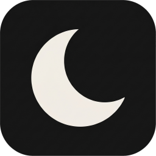
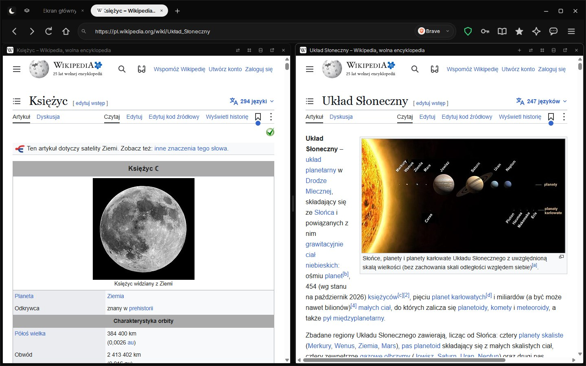
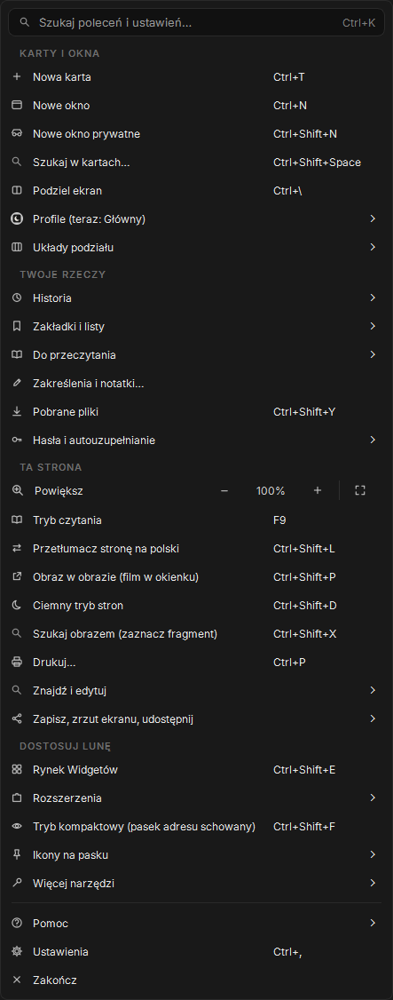
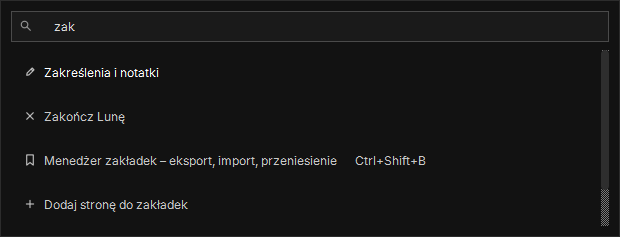
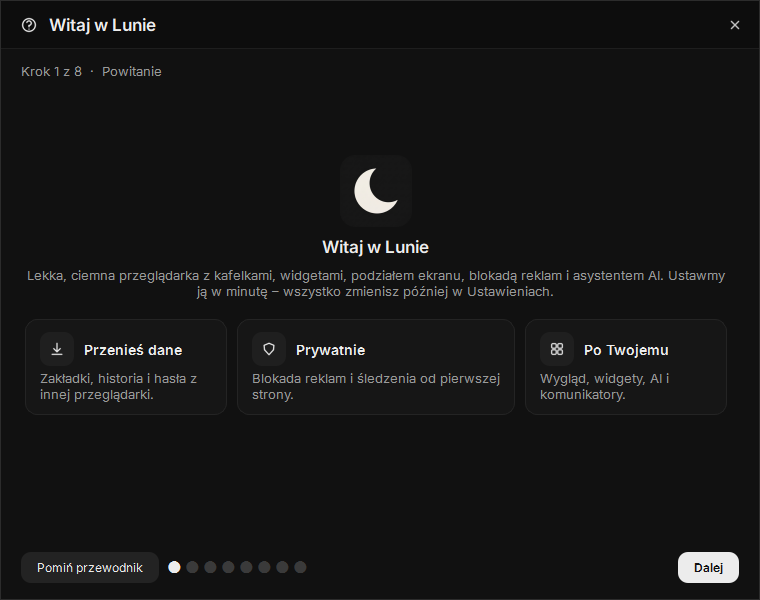

<p align="center">
  
</p>

<h1 align="center">Luna</h1>

<p align="center">
  <b>Lekka, ciemna przeglądarka dla Windows</b> – z kafelkami, widgetami, podziałem ekranu,<br>
  wbudowaną blokadą reklam i asystentem AI obok strony.
</p>

<p align="center">
  <a href="#jak-uruchomić">Jak uruchomić</a> ·
  <a href="#co-potrafi">Co potrafi</a> ·
  <a href="#do-czego-się-przyda">Do czego się przyda</a> ·
  <a href="#co-dalej">Co dalej</a> ·
  <a href="docs/privacy.html">Prywatność</a>
</p>

<p align="center">
  
</p>

---

## Dlaczego Luna

- **Wszystko w jednym oknie.** Strony, komunikatory, asystent AI i widgety (pogoda, zadania, notatki, rynki) obok siebie – bez instalowania rozszerzeń.
- **Prywatna od pierwszej strony.** Blokada reklam i śledzenia jest wbudowana, hasła są szyfrowane na Twoim komputerze, a Luna nie ma własnych serwerów i niczego o Tobie nie zbiera.
- **Szybka i oszczędna.** Nieużywane karty usypiają się same, a na baterii Luna zatrzymuje filmy w tle i zwalnia pamięć.
- **Po polsku.** Cały interfejs, podpowiedzi, menu stron i przewodnik są po polsku; tłumaczenie stron z dowolnego języka jednym kliknięciem.

## Co potrafi

<table>
<tr>
<td width="50%"></td>
<td width="50%"></td>
</tr>
<tr>
<td><b>Podział ekranu</b> – przeciągnij kartę na stronę: dwie albo trzy strony obok siebie, zapisane układy, wspólne przewijanie.</td>
<td><b>Tryb czytania</b> – sam tekst artykułu, bez reklam i rozpraszaczy (F9).</td>
</tr>
</table>

**Karty i okna**
- Grupy kart, przestrzenie robocze (np. Praca, Zakupy), karty przypięte, pionowy panel kart.
- Podział ekranu na 2–3 strony z podglądem przy przeciąganiu i zapisanymi układami („Praca: Gmail + Kalendarz + Notion”).
- Profile – osobna Luna do pracy i do domu, każdy z własnymi kartami, hasłami i logowaniami.
- Ostatnio zamknięte karty wracają z historią (Ctrl+Shift+T), a ekran główny pokazuje je jednym kliknięciem.

**Prywatność i bezpieczeństwo**
- Blokada reklam i śledzenia (listy uBlock Origin, EasyList, polskie filtry), także reklam na YouTube i wyskakujących okien.
- Pomijanie sponsorowanych wstawek na YouTube (SponsorBlock).
- Menedżer haseł szyfrowany na komputerze, kody 2FA, adresy do formularzy.
- Ostrzeżenie przed fałszywymi stronami logowania (podróbki banków i serwisów).
- Ukrywanie dowolnego elementu strony prawym przyciskiem myszy.

**Wygoda na co dzień**
- Paleta poleceń **Ctrl+K** – polecenia, karty, historia i ustawienia w jednym polu.
- Wyszukiwanie w aplikacjach z paska adresu: `yt koncert`, `sp lofi`, `tt @nazwa`, `ig #morze`.
- Tłumaczenie stron i zaznaczeń, tryb ciemny dla jasnych stron, obraz w obrazie, zrzuty ekranu (także całej strony).
- „Do przeczytania” z kopią offline, zakreślenia i notatki na stronach, podgląd linku bez otwierania karty.
- Szukanie obrazem (**Ctrl+Shift+X**) – zaznacz fragment strony: Google Lens albo pytanie do AI.
- Menedżer zakładek z eksportem i importem (plik HTML zgodny z Chrome, Edge, Firefoksem i Safari).

**AI i komunikatory**
- Panel AI z boku: ChatGPT, Claude, Gemini albo DeepSeek – „Podsumuj stronę”, „Zapytaj o stronę”, „Porównaj karty”.
- Panel komunikatorów: WhatsApp, Messenger, Telegram, Instagram, Discord i dowolne strony.

**Widgety** – seria aktywności, zadania, notatnik, Pomodoro, zegar, pogoda, rynki i waluty, wiadomości RSS, paczki (InPost, DPD, DHL…), odtwarzacz (steruje też Spotify), monitor zasobów, kalkulator, tłumacz i inne – wszystkie w Rynku Widgetów (Ctrl+Shift+E).

<table>
<tr>
<td width="34%"></td>
<td width="66%" valign="top">
<br><br>

</td>
</tr>
<tr>
<td>Menu w podpisanych grupach i wyszukiwarka poleceń.</td>
<td>Paleta Ctrl+K i przewodnik przy pierwszym uruchomieniu.</td>
</tr>
</table>

## Do czego się przyda

| Kto | Co dostaje |
|---|---|
| **Praca i biuro** | Profil „Praca” oddzielony od prywatnego, układ podziału z pocztą i kalendarzem jednym kliknięciem, komunikatory z boku, zadania i Pomodoro w panelu. |
| **Nauka** | Tryb czytania, zakreślenia i notatki, tłumaczenie z każdego języka, AI, które streści artykuł albo wyjaśni zaznaczony fragment, dwie strony obok siebie. |
| **Rozrywka** | YouTube bez reklam i sponsorowanych wstawek, obraz w obrazie, odtwarzacz w panelu, skróty `yt` i `sp` w pasku adresu. |
| **Słabszy laptop** | Usypianie nieużywanych kart, tryb oszczędzania baterii, menedżer zadań pokazujący, co zajmuje pamięć. |
| **Bezpieczeństwo** | Blokada śledzenia, ostrzeżenia przed podróbkami stron logowania, hasła i kody 2FA tylko na Twoim komputerze. |

## Jak uruchomić

Luna jest dziś uruchamiana z kodu źródłowego (Python). Gotowy instalator jest w planach – zobacz [Co dalej](#co-dalej).

**Wymagania:** Windows 10 lub 11, [Python](https://www.python.org/downloads/) 3.12 albo nowszy, ok. 500 MB miejsca (silnik przeglądarki).

1. **Zainstaluj Pythona** ze strony python.org. W instalatorze zaznacz **„Add python.exe to PATH”**.
2. **Pobierz Lunę** – przyciskiem **Code → Download ZIP** na tej stronie (i rozpakuj), albo przez git:
   ```bash
   git clone https://github.com/z4k0lzakol/Luna.git
   cd Luna
   ```
3. **Zainstaluj biblioteki** (w folderze Luny):
   ```bash
   python -m pip install -r requirements.txt
   ```
4. **Uruchom:**
   ```bash
   python luna.py
   ```
   Bez czarnego okna konsoli: `pythonw luna.py`. Skrót na pulpicie: prawy przycisk na pulpicie → Nowy → Skrót → `pythonw.exe "C:\ścieżka\do\Luna\luna.py"`.

Przy pierwszym uruchomieniu otworzy się **przewodnik**: przeniesie zakładki, historię i hasła z Chrome, Edge, Brave, Opery albo Vivaldi i pomoże ustawić wygląd, widgety i AI.

**Aktualizacje:** jeśli Luna została pobrana przez `git clone`, sama sprawdza nowe wersje i aktualizuje się jednym kliknięciem (Ustawienia → Aktualizacje), a potem pokazuje „Co nowego”.

**Plik .exe (dla twórców):** `powershell -ExecutionPolicy Bypass -File build.ps1` buduje `dist\Luna.exe` (PyInstaller).

<details>
<summary><b>Gdzie Luna trzyma dane</b></summary>

Wszystko jest w Twoim folderze użytkownika (`C:\Users\<Ty>`), w plikach i folderach zaczynających się od `.luna`:

- `.luna_ustawienia.json` – ustawienia, widgety, sesja kart,
- `.luna.json`, `.luna_historia.json`, `.luna_zakladki.json` – kafelki, historia, zakładki,
- `.luna_hasla.bin` – hasła (zaszyfrowane przez Windows),
- `.luna_profile` – profil przeglądarki (logowania do stron, ciasteczka),
- `.luna_profile_uzytkownikow\<nazwa>` – dodatkowe profile.

Kopię wszystkiego w jednym zaszyfrowanym pliku zrobisz w menu: Więcej narzędzi → Kopia zapasowa. Synchronizacja między komputerami działa przez folder OneDrive albo Dysku Google (Ustawienia → Synchronizacja) – bez serwerów Luny.
</details>

## Co dalej

Plany na kolejne wersje:

- [ ] **Instalator `Luna-Setup.exe`** – pobierasz, klikasz „Zainstaluj”, Luna pojawia się w menu Start i na pulpicie. Bez instalowania Pythona.
- [ ] **Podpis cyfrowy** – Windows nie pokaże już ostrzeżenia „Nieznany wydawca”.
- [ ] **Wydania na GitHubie (Releases)** – każda wersja z listą zmian i plikiem do pobrania; aktualizacje bez gita.
- [ ] **Luna jako domyślna przeglądarka** – linki z poczty i innych programów otwierają się w Lunie.
- [ ] **Jasny motyw i kolor akcentu**, archiwum starych kart, wersja przenośna (na pendrive).

Docelowo instalacja ma wyglądać tak: **pobierz → zainstaluj → przewodnik przenosi Twoje dane z poprzedniej przeglądarki** – i to wszystko.

## Prywatność

Luna działa w całości na Twoim komputerze i nie ma własnych serwerów. Logowania do stron zostają w lokalnym profilu, hasła są szyfrowane, a do zewnętrznych usług trafia tylko to, czego używasz (np. strona do tłumaczenia po kliknięciu „Przetłumacz”). Szczegóły: [polityka prywatności](docs/privacy.html).

---

<p align="center"><sub>Luna · silnik Chromium przez Qt WebEngine · napisana w Pythonie (PyQt6)</sub></p>
